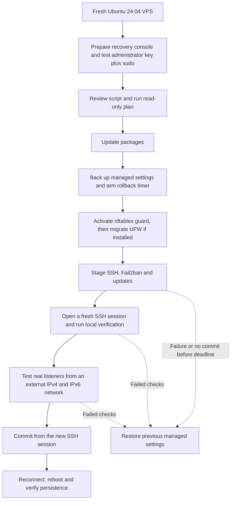
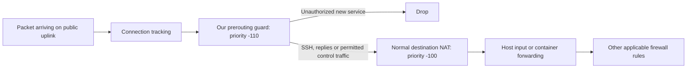

# VPS Hardening

Prepare a **fresh Ubuntu 24.04 LTS VPS** for application hosting: key-only SSH through a non-root administrator, automatic Ubuntu security updates, Fail2ban, and a persistent IPv4/IPv6 ingress firewall that also guards future Docker-published ports.

**No provider network firewall is required.** The host enforces the network policy. SSH remains reachable from any source IP; Fail2ban temporarily bans repeated authentication failures.

This guide is for someone who can connect with SSH and use `sudo`, but has not configured Linux firewalls before. Read the preparation and recovery steps before applying changes.

**Validation status:** the repository includes offline tests with mocked services and firewall commands. A complete Ubuntu VPS run, including reboot, external IPv6 tests, and timed recovery, remains required before treating this initial version as validated for production. A successful audit establishes the checks listed here; it does not certify that a host is free of compromise.

## Contents

- [Scope and Security Policy](#scope-and-security-policy)
- [Setup Flow](#setup-flow)
- [1. Prepare Recovery and Key Access](#1-prepare-recovery-and-key-access)
- [2. Review and Copy the Script](#2-review-and-copy-the-script)
- [3. Preview the Configuration](#3-preview-the-configuration)
- [4. Apply with Timed Rollback](#4-apply-with-timed-rollback)
- [5. Verify from a New SSH Session](#5-verify-from-a-new-ssh-session)
- [6. Test Public Port Blocking](#6-test-public-port-blocking)
- [7. Commit, Reconnect, and Reboot](#7-commit-reconnect-and-reboot)
- [Recovery](#recovery)
- [Control Rationale and References](#control-rationale-and-references)
- [After Phase 1](#after-phase-1)
- [Development and Acceptance Tests](#development-and-acceptance-tests)

## Scope and Security Policy

**Supported:** a booted Ubuntu 24.04 LTS system using systemd and OpenSSH, before Docker or applications are installed. Python 3 uses only its standard library. The administrator must already exist, belong to the `sudo` group, and have a tested public key in their home directory's `.ssh/authorized_keys`.

Examples use `ubuntu`. **That is a username**, common on Ubuntu cloud images, rather than a command or a required account name. Substitute your actual non-root administrator with `--admin`.

| Traffic or Capability | Final Policy |
| --- | --- |
| Public TCP ingress | Selected SSH port only |
| Public ports 80, 443, 3000 and databases | Blocked on protected interfaces |
| IPv4 and IPv6 | Same ingress policy |
| ICMP and ICMPv6 | Allowed for diagnostics and network control |
| DHCP replies | Allowed for IPv4/IPv6 address configuration |
| Replies to outbound connections | Allowed |
| New outbound connections | Allowed |
| SSH authentication | Public keys required; root login disabled |
| SSH source addresses | Unrestricted; repeated failures subject to Fail2ban |
| SSH forwarding | Local TCP forwarding retained for private setup; agent and X11 forwarding disabled |

**Fresh-host boundaries:** the script refuses Docker installations, listeners on 80/443/3000, active or enabled firewalld/distribution nftables services, and unrecognized nftables tables. It recognizes its own `inet vps_edge` table, Fail2ban's `inet f2b-table`, and inspected UFW compatibility tables during migration. Existing SSH settings that override its policy cause validation to fail.

Use a fresh provider image after a compromise. Reinstallation does not revoke stolen credentials: rotate external tokens, passwords, and keys that the old host could access. This script configures a baseline; it does not clean an infected operating system, configure disk encryption, or prevent an attacker with root access from changing the firewall.

## Setup Flow



The default rollback deadline is **20 minutes after package operations finish**, before configuration staging begins. The timer survives an accidental reboot and attempts recovery if its deadline passed while the VPS was offline. Keep the VPS running until commit succeeds.

Script commands report their results. The steps below identify the success marker and the next action. If a command reports `FAIL` or `ERROR`, resolve the reported problem or follow [Recovery](#recovery) before continuing. Expected outcomes remain explicit for manual checks that the script cannot perform.

**Package installation and upgrades are outside rollback.** Backups capture the configuration after package operations. Maintainer scripts may change services during upgrades, and the script cannot reverse those effects. The recovery console remains necessary even with automatic rollback.

## 1. Prepare Recovery and Key Access

### Secure the Provider Account

- Enable MFA on the provider account and recovery email.
- Confirm access to the provider's console or rescue environment independently of SSH.
- Record the VPS's public IPv4 and IPv6 addresses and initial login username.
- Verify the SSH host-key fingerprint through a trusted provider channel when available. After a reinstall, verify the changed fingerprint before replacing an old `known_hosts` entry.
- Keep the first SSH session open until a fresh connection works after commit.

A provider firewall is optional additional protection. If one already exists, allow the current and proposed SSH ports during migration. The procedure works without it.

### Identify the Account

**On the VPS:**

```bash
whoami
id -u
id -nG
sudo -v
```

**Expected:** `whoami` prints your account name, such as `ubuntu`. `id -u` prints a number other than `0`; `0` means root. Groups include `sudo`. `sudo -v` succeeds silently after any password prompt. Resolve a sudo failure before continuing.

**Only if the provider supplied root alone**, run these in the root session:

```bash
adduser ubuntu
usermod -aG sudo ubuntu
```

**Expected:** `adduser` prompts for a new local account password and account details. `usermod` normally succeeds silently. Choose a unique password; it can still be used for sudo after SSH password login is disabled. Skip these commands when the account already exists.

### Provision and Test a Key

**On your computer**, generate a dedicated key if needed:

```bash
ssh-keygen -t ed25519 -f ~/.ssh/vps_admin
```

**Expected:** prompts for a passphrase, then paths for a private key and a `.pub` public key. Choose a passphrase. Do not overwrite an existing key or copy the private key to the VPS.

Replace `VPS_IP` with your server address. These examples assume the current SSH port is `22`; use the actual port if different:

```bash
ssh-copy-id -p 22 -i ~/.ssh/vps_admin.pub ubuntu@VPS_IP
ssh -p 22 -i ~/.ssh/vps_admin -o IdentitiesOnly=yes -o PasswordAuthentication=no -o KbdInteractiveAuthentication=no ubuntu@VPS_IP
```

**Expected:** `ssh-copy-id` installs the public key using existing access. The second command opens a shell using that key, possibly asking for its local passphrase. A server-account password prompt is not acceptable for this test. If password login was never available, provision the public key through the provider console instead.

**In that new VPS shell:**

```bash
sudo -v
```

**Expected:** sudo succeeds. Confirm that `.ssh` and `authorized_keys` are owned by this administrator with permissions `700` and `600`, respectively, when installing the key manually. Avoid SSH agent forwarding (`ssh -A`) during ordinary administration.

## 2. Review and Copy the Script

**On your computer:**

```bash
git clone https://github.com/ltpquang/vps-hardening.git
cd vps-hardening
git rev-parse HEAD
less scripts/phase1.py
```

**Expected:** Git creates the repository directory and prints the checked-out commit hash. Record that hash with your setup notes so you can identify the version used. `less` displays the script; press **q** to exit. Review a specific version before executing it with root privileges.

Copy the reviewed file:

```bash
scp -P 22 -i ~/.ssh/vps_admin scripts/phase1.py ubuntu@VPS_IP:phase1.py
```

**Expected:** transfer completes. This command copies the script without executing it.

**On the VPS**, install a copy that only root can modify:

```bash
sudo install -d -m 700 /root/bootstrap
sudo install -m 700 ~/phase1.py /root/bootstrap/phase1.py
sudo /usr/bin/python3 /root/bootstrap/phase1.py --help
```

**Expected:** both `install` commands succeed silently. Help lists `plan`, `apply`, `verify`, `commit`, and `rollback`.

## 3. Preview the Configuration

Identify the network interfaces first:

```bash
ip -br address
ip -4 route show default
ip -6 route show default
```

**Expected:** `lo` is the loopback interface. An interface such as `ens3` carries the VPS's addresses, and default routes identify the outbound uplink(s). IPv4 and IPv6 can use different interfaces. No IPv6 default route is normal on an IPv4-only host.

The script discovers default-route interfaces and interfaces with global addresses. Inspect the result; provider-specific routed or tunneled networks can require manual review.

```bash
sudo /usr/bin/python3 /root/bootstrap/phase1.py plan --admin ubuntu
```

**Success:** `PLAN ONLY` confirms a read-only preview. Review the administrator, interfaces, SSH ports, and proposed changes before applying.

| Option | Use |
| --- | --- |
| Omit `--ssh-port` | Keep the current SSH port |
| `--ssh-port 2222` | Stage a migration to port 2222 |
| `--interface ens3` | Explicitly select one public uplink |
| Repeated `--interface` | Include each public uplink |
| `--migrate-ufw` | Replace a reviewed live or custom UFW policy |
| `--skip-packages` | Skip package operations on an already-patched host with prerequisites installed |
| `--rollback-minutes 30` | Preview or apply a 30-minute confirmation window |

For example, a migration on an `ens3` host is previewed with:

```bash
sudo /usr/bin/python3 /root/bootstrap/phase1.py plan --admin ubuntu --interface ens3 --ssh-port 2222
```

**Review:** the selected port must be `2222`, the interface must be `ens3`, and the staging ports must include the old port. The script rejects a list that omits a detected uplink.

Changing the SSH port reduces routine scanning noise. Public-key authentication provides the authentication control. Keep port 22 if migration adds no operational benefit.

### UFW on a Fresh Image

A provider image can have `ufw.service` enabled or active while UFW itself reports `Status: inactive`. The script checks both states. `plan` displays the running policy, saved rules, and any detected configuration changes without disabling UFW.

- **Inactive with no detected custom policy:** apply migrates UFW automatically, even when its service is enabled.
- **Active or containing saved/custom rules:** review the plan, then add `--migrate-ufw` to apply if you intend to replace that policy. This includes policies supplied by the provider.
- **Unrecognized firewall objects:** reconcile them manually; the migration flag does not override this refusal.

Migration replaces UFW's policy with this guide's SSH-only ingress policy. It does not translate existing service exceptions, source restrictions, routing rules, or outbound restrictions. If replacement is intended, append `--migrate-ufw` to the apply command in step 4. Retain any interface, port, or package options from your reviewed plan. Do not disable UFW manually first.

The script saves `/etc/ufw/` and `/etc/default/ufw`, arms rollback, and activates the persistent nftables guard before disabling UFW. Recovery restores UFW configuration, its runtime policy, and its service state before removing the staged guard. If UFW restoration fails, recovery keeps the staged guard and reports an incomplete rollback for console repair.

## 4. Apply with Timed Rollback

Use the same administrator, interface, port, and package options that you reviewed. This example keeps the current port and uses automatic interface detection:

```bash
sudo /usr/bin/python3 /root/bootstrap/phase1.py apply --admin ubuntu
```

**Success:** `STAGED RUN: RUN_ID` appears with a rollback deadline, backup directory, and next commands. Configuration awaits confirmation; both old and selected SSH ports remain permitted. Continue with a new SSH session before the deadline.

If using the migration preview above, add `--interface ens3 --ssh-port 2222` to apply as well. `--rollback-minutes` accepts 5 through 120 minutes in both `plan` and `apply`. Planning displays the window without arming a timer; repeat the option when applying because plans are not saved. Allow enough time for the external checks.

**Record the actual run ID outside the VPS.** In the following commands, replace every `RUN_ID` with that value. Run directories live under `/var/lib/vps-phase1/` and contain root-only backups, state, and a saved copy of the script. They can contain sensitive configuration and login metadata.

If staging fails, the script attempts rollback immediately. A lost terminal or interrupted process leaves the timer available for recovery. Do not install applications or reboot while the run awaits commit.

## 5. Verify from a New SSH Session

**On your computer**, open a second terminal. Use the port selected by apply; `22` below is an example:

```bash
ssh -p 22 -i ~/.ssh/vps_admin -o IdentitiesOnly=yes -o ControlMaster=no -o ControlPath=none -o PasswordAuthentication=no -o KbdInteractiveAuthentication=no ubuntu@VPS_IP
```

**Expected:** a fresh key-authenticated shell. The multiplexing options prevent SSH from reusing the old connection. An old connection can survive a broken new-login configuration, so it cannot establish that the new settings work.

**In the new VPS session:**

```bash
sudo -v
sudo /usr/bin/python3 /var/lib/vps-phase1/RUN_ID/phase1.py verify --run-id RUN_ID
```

**Success:** sudo succeeds; verification reports `state: awaiting_commit` and all checks pass. Continue with the external listener tests.

Verify the rollback deadline is scheduled:

```bash
sudo systemctl list-timers vps-phase1-rollback.timer --all --no-pager
```

**Expected:** an upcoming activation for `vps-phase1-rollback.service` at the printed deadline.

**The audit is local.** Successful SSH and matching firewall text do not prove that another port is blocked from the internet. Complete the listener tests below before commit.

## 6. Test Public Port Blocking

A failed connection to a port with no listener proves little. Start a real listener, prove it works locally, then try the same port from outside the VPS.

### IPv4 Listener

**In a separate VPS terminal:**

```bash
test_dir=$(mktemp -d)
python3 -m http.server 3000 --bind 0.0.0.0 --directory "$test_dir"
```

**Expected:** a message that the server is listening on port `3000`; the terminal stays occupied. It serves an empty temporary directory.

**From another VPS session:**

```bash
curl --noproxy '*' --connect-timeout 5 http://127.0.0.1:3000/
```

**Expected:** an HTML directory listing. This proves the listener is working.

**From your computer**, using the direct public IP rather than a proxied hostname:

```bash
curl --noproxy '*' --connect-timeout 5 http://VPS_IPV4:3000/
```

**Expected:** a connection timeout, usually curl exit code `28`, with no HTTP response. If it succeeds, stop and investigate the interface selection and live firewall. Stop the VPS listener with **Ctrl+C** before testing IPv6.

### IPv6 Listener

If the VPS has public IPv6, repeat in the same listener terminal:

```bash
python3 -m http.server 3000 --bind :: --directory "$test_dir"
```

**Expected:** a message that the server is listening on IPv6 port `3000`.

**From another VPS session:**

```bash
curl --noproxy '*' -g --connect-timeout 5 'http://[::1]:3000/'
```

**Expected:** an HTML listing.

**From an external network with working IPv6:**

```bash
curl --noproxy '*' -g --connect-timeout 5 'http://[VPS_IPV6]:3000/'
```

**Expected:** connection timeout with no HTTP response. `Network is unreachable` on your computer means the IPv6 test is inconclusive. Use another IPv6-capable network before asserting coverage. On an IPv4-only VPS, record IPv6 as unavailable and repeat these checks if IPv6 is added later.

Stop the listener with **Ctrl+C**, then clean up its empty directory:

```bash
rmdir "$test_dir"
```

**Expected:** silent success.

When another upstream firewall exists, an external failure establishes combined protection. Validate the host rules too; an upstream block alone does not establish that the host guard works.

## 7. Commit, Reconnect, and Reboot

After the new key login, sudo, local audit, and applicable external tests pass, run this **from the new administrator SSH session**:

```bash
sudo /usr/bin/python3 /var/lib/vps-phase1/RUN_ID/phase1.py commit --run-id RUN_ID --external-checks-passed
```

**Success:** `COMMITTED RUN_ID` confirms the final SSH port and disables automatic rollback. Open another fresh connection before rebooting. The external-checks flag records your assertion; it does not run a remote scan.

Commit rejects an old SSH session, the wrong administrator or port, an expired deadline, and detected configuration drift. A failed final activation attempts rollback. Do not bypass the new-session requirement through the console.

**On your computer:** repeat the fresh SSH login command with the selected port. **Expected:** login succeeds again. If using an optional upstream firewall, retire its old port rule only after this succeeds.

**On the VPS:**

```bash
sudo reboot
```

**Expected:** SSH disconnects. Reconnect after the VPS finishes booting, then run:

```bash
sudo -v
sudo /usr/bin/python3 /var/lib/vps-phase1/RUN_ID/phase1.py verify --run-id RUN_ID
sudo ss -lntup
```

**Check:** sudo succeeds and verification reports `state: committed` with all checks passing. Review the listeners and processes listed by `ss`, investigating unexplained services even when the firewall blocks them. Repeat the external listener tests after reboot to check persistence.

### Check Security Updates

```bash
sudo unattended-upgrade --dry-run --debug
systemctl list-timers apt-daily.timer apt-daily-upgrade.timer --all --no-pager
```

**Expected:** the dry run lists allowed package origins and proposed security upgrades without installing them. Both timers have scheduled runs. Investigate missing Ubuntu security origins, repository failures, held packages, or update errors. Ubuntu's defaults cover its archive; third-party repositories and container images need separate maintenance.

```bash
if test -f /var/run/reboot-required; then cat /var/run/reboot-required; else echo 'No reboot required'; fi
```

**Expected:** `No reboot required` after a completed patch/reboot cycle, or a message that another reboot is required. Schedule any remaining reboot and verify access again. The script does not enable automatic reboots.

### Check Fail2ban Enforcement

This uses a documentation-only address, not your real administration IP:

```bash
sudo fail2ban-client set sshd banip 192.0.2.123
sudo fail2ban-client get sshd banip
sudo nft list table inet f2b-table
sudo fail2ban-client set sshd unbanip 192.0.2.123
```

**Expected:** the ban succeeds; the ban list and nftables table contain `192.0.2.123`. The final command removes the test ban. Exact numeric acknowledgements vary by Fail2ban version. Check both IPv4 and IPv6 action support on the target image; the configured nftables action is intended for both.

### Completion Checklist

- [ ] Provider MFA and console/rescue recovery are ready.
- [ ] A fresh public-key login and sudo work after reboot.
- [ ] Verification reports `committed` and all checks pass.
- [ ] A live port-3000 listener is blocked externally over every available public address family.
- [ ] The detected interface list covers every public ingress path.
- [ ] Security update origins and timer schedules have been reviewed.
- [ ] Fail2ban creates a ban rule and the test address has been unbanned.
- [ ] Unexpected services have been investigated.
- [ ] The script version, run ID, SSH port, addresses, and recovery notes are recorded securely.

## Recovery

### Restore an Uncommitted Run

Rollback restores managed files, the previous live `vps_edge` table, recorded service states, and UFW when migration began. Installed/upgraded packages remain. From a working session or the provider console:

```bash
sudo /usr/bin/python3 /var/lib/vps-phase1/RUN_ID/phase1.py rollback --run-id RUN_ID
```

**Success:** `ROLLED BACK RUN_ID`. Test a fresh SSH connection before continuing. An already committed or rolled-back run is a no-op, so an old timer cannot undo a committed configuration.

If rollback is incomplete:

```bash
sudo journalctl -u vps-phase1-rollback.service -n 50 --no-pager
sudo cat /var/lib/vps-phase1/RUN_ID/state.json
```

**Expected:** the journal shows recovery attempts; `state.json` includes status and any `rollback_errors`. No journal entries is normal when automatic rollback never ran. Review privately. The recovery service retries failed attempts; use the console to correct the reported failure.

Rollback may restore an earlier policy with less protection, including no host guard. Re-establish a working baseline before installing applications.

### Remove an Accidental SSH Ban

From the provider console, replace `YOUR_CLIENT_IP` with the address shown in the ban list:

```bash
sudo fail2ban-client get sshd banip
sudo fail2ban-client set sshd unbanip YOUR_CLIENT_IP
```

**Expected:** the first command lists banned addresses; the second removes the selected ban. Do not test banning your own address during setup.

### Recover After Commit

Automatic rollback is intentionally unavailable after commit. Inspect the root-only backups and restore the specific affected file through the console, validate its syntax, and reload the relevant service. Avoid replaying an old backup over later infrastructure changes.

**Never run `nft flush ruleset` to recover.** It removes unrelated protection and Docker networking rules. The script owns only `inet vps_edge`; Fail2ban owns its separate table.

## Control Rationale and References

### SSH Access

Requiring public keys removes SSH password guessing as an authentication path. Disabling direct root login makes the named administrator and sudo the normal administration route. The script requires tested access first because an installed public key alone cannot establish that the operator owns its private key.

| Setting | Purpose |
| --- | --- |
| `PubkeyAuthentication yes` | Enable public-key authentication |
| `AuthenticationMethods publickey` | Require a public key |
| `PermitRootLogin no` | Disable direct root SSH |
| `PasswordAuthentication no` | Disable password authentication |
| `KbdInteractiveAuthentication no` | Disable interactive authentication, including password prompts through PAM |
| `HostbasedAuthentication no`, `GSSAPIAuthentication no` | Disable unused alternative authentication methods |
| `AllowAgentForwarding no` | Disable OpenSSH agent forwarding |
| `X11Forwarding no` | Disable remote graphical display forwarding |
| `AllowTcpForwarding local`, `DisableForwarding no` | Retain local tunnels for private setup and recovery |

These choices suit public-key administration without SSH MFA. If you need PAM-based SSH MFA, revise the authentication policy deliberately. Forwarding restrictions remove built-in forwarding features; a user with shell access can run other forwarding software.

OpenSSH generally uses the first value it reads. The script checks effective settings, including a client-specific evaluation, rather than assuming its drop-in takes precedence. It supports service and socket activation, checks listener consistency, and uses a fresh SSH session before commit. Arbitrary existing `Match` blocks and customized socket overrides require manual review.

References: [OpenSSH server configuration](https://man.openbsd.org/sshd_config), [Ubuntu OpenSSH guide](https://ubuntu.com/server/docs/how-to/security/openssh/), [Ubuntu 24.04 socket activation](https://documentation.ubuntu.com/release-notes/24.04/).

### Firewall Before Docker Destination Translation

Docker can divert published-port traffic before the input chains used by UFW. This project creates an independent nftables table, `inet vps_edge`, and checks incoming packets on the named public interfaces **before normal destination address translation (DNAT)**. The early drop prevents an unauthorized public port from reaching either a host listener or a Docker-published service.



Smaller priority numbers run first. An `accept` in this guard still allows later hooks to filter the packet. Established/related replies support outbound connections; ICMPv6 permits essential IPv6 network control. Filtering follows interface names: if the actual public interface is `ens3` but rules name `ens4`, public traffic never enters the guard. Verification rechecks detected uplinks, and the external listener tests check the resulting behavior.

The `inet` family covers both IPv4 and IPv6. Host-only, container-only, internal, and loopback interfaces are outside the public-interface guard unless explicitly selected. Confirm all ingress paths on hosts with additional uplinks or provider tunnels. The intended deployment is one VPS, not a router or multi-node Swarm cluster.

Persistence comes from `vps-edge.service`. A Docker systemd drop-in requires it and orders Docker startup after it. The dependency establishes startup ordering; it does not monitor live rules continuously or stop a root user from deleting them. Do not enable a second firewall manager, disable Docker's normal firewall management, or load a configuration that flushes the full ruleset.

UFW migration uses its supported disable/enable commands and preserves its saved configuration for recovery. The migration flag explicitly accepts replacing an existing policy; it does not assert that the image is unmodified.

References: [Ubuntu UFW manual](https://manpages.ubuntu.com/manpages/noble/man8/ufw.8.html), [Docker packet filtering and UFW behavior](https://docs.docker.com/engine/network/packet-filtering-firewalls/), [Netfilter hook priorities](https://wiki.nftables.org/wiki-nftables/index.php/Netfilter_hooks), [nftables address families](https://wiki.nftables.org/wiki-nftables/index.php/Nftables_families), [systemd dependency semantics](https://www.freedesktop.org/software/systemd/man/latest/systemd.unit.html).

### Fail2ban

SSH is intentionally public from all source IPs. Fail2ban reads authentication failures from the systemd journal and temporarily rejects clients that reach five failures within ten minutes. Its nftables action bans the configured SSH port(s) for one hour. Public-key authentication remains the main login control; bans reduce repeated attempts and log noise.

References: [Fail2ban jail configuration](https://github.com/fail2ban/fail2ban/blob/master/config/jail.conf), [systemd journal backend](https://github.com/fail2ban/fail2ban/blob/master/fail2ban/server/filtersystemd.py), [nftables action](https://github.com/fail2ban/fail2ban/blob/master/config/action.d/nftables.conf).

### Updates and Recovery

Package updates precede managed SSH changes so the procedure uses the updated OpenSSH package. APT periodic configuration and systemd timers schedule unattended Ubuntu updates. Review actual update origins and logs; a scheduled timer alone cannot prove that every package was patched.

Backups cover the seven managed paths below and, when UFW is installed, its configuration files and service/runtime state. The script changes their contents atomically, saves prior service states and live guard rules, and arms a persistent calendar timer before applying network changes. A fresh session and an operator assertion of external tests are required before it disarms recovery.

| Managed Path | Purpose |
| --- | --- |
| `/etc/ssh/sshd_config.d/00-local-security.conf` | SSH authentication and forwarding |
| `/etc/ssh/sshd_config.d/00-local-ports.conf` | SSH listener ports |
| `/etc/vps-edge.nft` | Public-interface guard |
| `/etc/systemd/system/vps-edge.service` | Persistent guard service |
| `/etc/systemd/system/docker.service.d/10-firewall.conf` | Future Docker startup dependency |
| `/etc/fail2ban/jail.d/sshd.local` | Journal-backed SSH jail |
| `/etc/apt/apt.conf.d/20auto-upgrades` | Periodic update settings |

Missing managed files are created. The SSH drop-ins are project configuration, not files expected to exist on a fresh image. Rollback restores their original contents or removes them if they were absent.

References: [Ubuntu automatic updates](https://ubuntu.com/server/docs/how-to/software/automatic-updates/), [systemd persistent timers](https://www.freedesktop.org/software/systemd/man/latest/systemd.timer.html).

## After Phase 1

**Keep ports 80, 443, and 3000 blocked while setting up Dokploy.** Phase 1 does not install Docker, Dokploy, or Cloudflare software.

For a Cloudflare-protected dashboard, prepare an Access application with restricted identities and MFA before publishing the tunnel route. Install Dokploy only after the ingress guard is verified. Create its owner account privately, for example through a local SSH tunnel, before exposing its hostname through Tunnel and Access. Bind origin services to loopback where the deployment supports it and keep direct public access blocked.

A tunnel carries traffic; Access supplies the identity policy. Application credentials, authorization, updates, backups, and secret rotation still need explicit management. If applications later require direct public HTTP/HTTPS, review the ingress policy before opening 80/443, then repeat external tests. Multi-node deployments require a separate network design.

Once Docker is installed, **do not rerun Phase 1 apply**. The audit records this initial configuration; later intentional changes can report drift. Handle those changes as reviewed configuration updates.

References: [Dokploy production hardening](https://docs.dokploy.com/docs/core/guides/production-hardening), [Cloudflare self-hosted Access applications](https://developers.cloudflare.com/cloudflare-one/access-controls/applications/http-apps/self-hosted-public-app/), [Cloudflare Tunnel](https://developers.cloudflare.com/cloudflare-one/networks/connectors/cloudflare-tunnel/).

## Development and Acceptance Tests

Run offline checks from the repository root:

```bash
python3 -m unittest discover -s tests -v
python3 -m py_compile scripts/phase1.py tests/test_phase1.py
```

**Expected:** unittest reports `OK`; compilation succeeds silently. Tests use temporary directories and mocked system commands. They do not change accounts, `/etc`, services, or firewall rules. CI runs the same checks on Ubuntu 24.04.

Before releasing a version for production use, test it on a disposable Ubuntu 24.04 VPS with working console access:

- **SSH modes:** test the image's default socket activation and service-based activation.
- **Port choices:** test retaining the existing port and migrating to another port.
- **Network families:** test IPv4 and IPv6 listeners from outside the VPS, before and after reboot.
- **UFW migration:** test an inactive but enabled installation, an active SSH-only policy, and custom saved rules. Confirm explicit migration is required for live/custom policies, SSH works afterward, and rollback restores the prior policy and boot state.
- **Recovery:** deliberately leave a staged run uncommitted and verify automatic restoration after its deadline. Also test manual rollback and recovery after disconnecting the staging session.
- **Failures:** confirm an old SSH session cannot commit and an overridden SSH directive causes safe failure.
- **Docker handoff:** after committing, install Docker on the disposable host, publish a harmless container on port 3000, and prove it works locally while remaining blocked externally. Confirm Docker starts after the guard on reboot.

Record the image, package versions, script commit, test results, and recovery outcome. Passing mocked tests does not establish these live behaviors.

Writing follows [The Elements of Agent Style](https://github.com/yzhao062/agent-style): explain the purpose before the mechanism, use consistent terms, and support technical claims with references. See [AGENTS.md](AGENTS.md) for contributor guidance.
